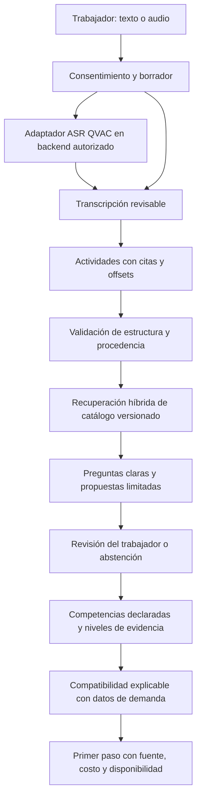

# Auditoría de inteligencia artificial y QVAC

Fecha: **20-10-2026 (America/Lima)**. Base: `c24523f1bee8a64a21a8a1d2a9bdeee128415c69`. Evidencia: código y resultados versionados, inspección del SDK instalado y documentación oficial de la línea **v0.22**. No se ejecutó nueva inferencia ni se descargaron pesos; los tiempos históricos se presentan como reportados.

## Dictamen

**QVAC sí está integrado en un experimento real de línea de comandos. No está integrado en una aplicación de usuario ni demuestra todavía identificación fiable de competencias.** Los scripts importan y llaman ASR, LLM y búsqueda semántica locales. Los JSON guardados son evidencia documental de ejecuciones anteriores, no una reproducción auditora de esas ejecuciones.

La decisión de que la IA proponga y la persona confirme es adecuada. Necesita una modificación: **la confirmación del trabajador conserva el nivel de autodeclaración**; no transforma una sugerencia errónea en una competencia verificada. Hace falta abstención, evidencia contextual y evaluación progresiva. Un modelo mayor puede mejorar el desempeño, pero no resuelve por sí solo la falta de validación y el catálogo incompleto.

Calificación orientativa de auditor: **integración experimental QVAC 6/10; evaluación ASR 4/10; vinculación semántica fiable 2/10; IA de producto validada 1/10; offline y hardware objetivo comprobados 0/10**. Son juicios de madurez, no mediciones automatizadas.

## Qué se usa realmente

| Etapa | Implementación comprobada | Lo que no demuestra |
|---|---|---|
| Voz | `voz.mjs:24` compara Whisper Small Q8 y Parakeet TDT 0.6B v3 Q8; ambos spikes usan Parakeet | Micrófono en navegador, ruido/acento real, lenguas originarias, recuperación de errores |
| Actividades | Qwen3 4B por defecto; `competencias.mjs:66` con contexto 8192, v2:46 con 4096 | Entrevista adaptativa o precisión medible contra anotación de experto |
| Formato | `completion`, `responseFormat` JSON Schema y `run.final`; v1:44, v2:33 | Veracidad de citas, inferencia causal de habilidad o validez de una certificación |
| Búsqueda | EmbeddingGemma 300M Q8 + `ragIngest`/`ragSearch`; v1:79, v2:53 | Recall/precision calibrados, ranking laboral ni confiabilidad de una ocupación puente |
| Decisión | v1 juzga hasta 25 candidatos; v2 evalúa cada par con booleano | D-004 no está implementada como interacción humana; el CLI decide solo |
| Cercanía | Fracción de estándares atribuidos sobre total del perfil; v1:122 | Demanda regional, vacantes, probabilidad de contratación ni requisitos completos del oficio |
| Evidencias | No hay análisis de fotos, autenticidad, microevaluaciones ni referencias | No existe verificación laboral automática |
| Dependencias externas | No se hallaron llamadas de relatos a APIs comerciales en fuente propia | No se capturó tráfico ni se demostró aislamiento de red; QVAC puede descargar modelos |

Versiones: `spike-qvac/package.json:14` pide `^0.22.0`; `package-lock.json:846` fija `0.22.0`; `node_modules/@qvac/sdk/package.json:3` coincide. La documentación resuelta desde [índice de líneas SDK](https://docs.qvac.tether.io/sdk/llms.txt) identifica v0.22 como línea correspondiente. No se extrapolaron instrucciones de otra versión.

## Capacidades verificadas con documentación oficial

- **Runtime:** QVAC JS/TS funciona en Node/Bare y móvil mediante Expo; requiere Node ≥22.17, y el empaquetado móvil tiene requisitos mayores. Expo requiere dispositivo físico. Las plataformas documentadas no incluyen ejecución nativa en navegador. Un frontend web debe hablar con un backend de aplicación. [JS/TS SDK](https://docs.qvac.tether.io/sdk/js-ts-sdk), [funcionamiento interno](https://docs.qvac.tether.io/sdk/how-it-works).
- **ASR:** la API acepta archivo o buffer; `modelType: 'parakeet-transcription'` corresponde a Parakeet y `whisper` al otro motor. Los modelos y sus variantes determinan idiomas/capacidades. En Apple, Parakeet puede descargar además un encoder Core ML; no asumir que el archivo principal representa todo el disco ni que una GPU concreta se usó. [Transcripción](https://docs.qvac.tether.io/sdk/ai-capabilities/transcription).
- **Texto y JSON:** el motor admite generación local y restricciones estructuradas. La declaración instalada `node_modules/@qvac/sdk/dist/src/client/api/completion-stream.d.ts:33` documenta `json_schema`; formato válido no acredita contenido correcto. La documentación de batch también explicita estos formatos. [Generación de texto](https://docs.qvac.tether.io/sdk/ai-capabilities/text-generation), [batch](https://docs.qvac.tether.io/sdk/ai-capabilities/batch-processing), [referencia API](https://docs.qvac.tether.io/sdk/reference/api).
- **RAG:** se admiten embeddings, workspaces y almacenamiento alternativo. La propia documentación limita el almacén vectorial integrado a prototipos; para producción propone alternativas de persistencia. No se debe convertir el workspace del spike en almacenamiento productivo por defecto. [RAG](https://docs.qvac.tether.io/sdk/ai-capabilities/rag).
- **Memoria y operación:** `assessModelFit()` estima ajuste en memoria, no garantiza velocidad ni reserva recursos. `profiler` permite instrumentar cargas/inferencias y recursos. Los mínimos del runtime no son requisitos suficientes de este conjunto de modelos. [Ajuste de modelo](https://docs.qvac.tether.io/sdk/models/assess-model-fit), [profiler](https://docs.qvac.tether.io/sdk/runtime/profiler), [requisitos](https://docs.qvac.tether.io/sdk/system-requirements).
- **Red:** la carga puede obtener/cachar modelos; local describe el lugar de inferencia. La configuración no implica aislamiento de red. Para entornos con datos personales, precargar artefactos verificados, limitar egreso por infraestructura y comprobar tráfico; no se verificó una opción global de desactivar toda red. [Configuración](https://docs.qvac.tether.io/sdk/configuration), [funcionamiento interno](https://docs.qvac.tether.io/sdk/how-it-works).
- **Límites adicionales:** no se verificó soporte de quechua/aimara con estos pesos, detección de fraude en fotos ni capacidad de certificar competencias. La disponibilidad de OCR/multimodal en el SDK no acredita autenticidad documental. QVAC también documenta un API de decisiones con checkpoints específicos, pero no se ha probado en este dominio; cambiar de API no constituye validación. [Decisiones](https://docs.qvac.tether.io/sdk/ai-capabilities/decisions).

Se contrastó la ficha oficial de [Qwen3-4B](https://huggingface.co/Qwen/Qwen3-4B), que documenta el control `/no_think`; el spike lo añade al sistema. La ficha oficial de [EmbeddingGemma](https://huggingface.co/google/embeddinggemma-300m) confirma finalidad de búsqueda multilingüe, dimensiones y prompts de consulta/documento. Los prefijos usados son coherentes con ese patrón. Esto no valida la cuantización concreta, el tokenizador o el ranking en español peruano: requiere experimentación propia.

## Qué dicen los resultados guardados

### Voz: métrica original y recálculo

`voz.mjs:16` cuenta cuántas palabras del guion aparecen **en un conjunto** de palabras transcritas. Ignora orden y multiplicidad, y no penaliza todas las inserciones. Por tanto, «97 %» es **cobertura léxica de referencia**, no exactitud ASR ni WER. Una transcripción con muchas palabras extra puede conservar ese porcentaje.

Se recalcularon las distancias de Levenshtein sobre palabras usando únicamente `audio/*.txt` y `resultados/voz.json`. Normalización explícita: minúsculas; descomposición NFD y supresión de diacríticos; signos convertidos a espacios; separación por espacios. No se normalizaron números hablados a dígitos ni nombres propios. Fórmula: **WER = distancia mínima de edición de palabras / número de palabras del guion**, equivalente a `(sustituciones + eliminaciones + inserciones) / N`. Estos valores son de esta auditoría, no nuevas salidas del ASR.

| Motor / relato | N del guion | Distancia | WER recalculado | Cobertura original recalculada |
|---|---:|---:|---:|---:|
| Whisper / Jhon | 118 | 26 | 22,034 % | 88 % |
| Whisper / Rosa | 94 | 5 | 5,319 % | 96 % |
| Parakeet / Jhon | 118 | 6 | 5,085 % | 97 % |
| Parakeet / Rosa | 94 | 4 | 4,255 % | 97 % |

La transformación «treinta y cuatro» → «34» penaliza este WER; se necesita una segunda política normalizada para uso práctico, conservando ambas. No debe anunciarse «95 % de precisión» a partir de `100 − WER`: no mide calidad semántica, datos personales críticos ni desempeño poblacional. Solo hay dos personas ficticias, voz sintética y sin ruido (`PLAN_DE_PROYECTO.md`, sección 7).

Los WAV inspeccionados tienen un canal, PCM de 16 bits y 16 kHz; duración calculada con cabecera WAV: **Jhon 40,900 s; Rosa 35,812 s**. Los tiempos **reportados** en `resultados/voz.json:5` son Whisper 2,7/2,0 s y Parakeet 0,3/0,2 s; carga 56,9/155,6 s respectivamente. Son valores redondeados de una ejecución guardada, sin distribución ni separación explícita entre descarga e inicialización. No se reprodujeron la velocidad, RAM, CPU/GPU o consumo energético.

### Competencias: evidencia adversa ya disponible

- **v1 Jhon:** 36 elementos en `confirmadas`, pero solo **15 códigos únicos**; aparece housekeeping con todas sus unidades atribuidas (`resultados/jhon-QWEN3_4B_INST_Q4_K_M.json:569,863`). El relato trata de celulares.
- **v1 Rosa:** 61 elementos en `confirmadas`, solo **12 códigos únicos**; el ranking atribuye perfiles completos de corta forestal y manejo silvicultural (`resultados/rosa-QWEN3_4B_INST_Q4_K_M.json:733,1236`). Coser/cortar tela no acredita tala de árboles.
- **v2 Jhon:** 35 pares evaluados, 15 `true`, 15 códigos distintos. «Explicando qué tiene el equipo» se acepta para equipo pesado; «enseñando a mi sobrino» para cuidado infantil (`resultados/v2-jhon-QWEN3_4B_INST_Q4_K_M.json:155,238`).
- **v2 Rosa:** 39 pares evaluados, 11 `true`, 10 códigos distintos. No hay etiquetas expertas para declarar su precision/recall global.
- **Citas:** una cita de actividades de v1 Jhon no aparece literalmente en el relato ni ignorando mayúsculas; contiene «Sanían». Otras citas sí son subcadenas pero no respaldan la actividad atribuida. Copiar una cita existente no basta para demostrar correspondencia semántica.

Los tiempos **reportados**, sin nueva inferencia, son:

| Resultado | Extracción de actividades | Búsqueda | Juicio LLM | Advertencia |
|---|---:|---:|---:|---|
| v1 Jhon | 24,7 s | 0,5 s | 77,6 s | Carga LLM adicional 3,0 s y ASR 0,3 s; no tiempo end-to-end completo |
| v1 Rosa | 14,1 s | 0,2 s | 81,7 s | Carga LLM adicional 3,0 s y ASR 0,2 s |
| v2 Jhon | 12,8 s | 0,2 s | 21,0 s | Cargas de modelos fuera de estos cronómetros |
| v2 Rosa | 9,8 s | 0,2 s | 21,3 s | Cargas fuera; no comparación controlada con v1 |

En el **commit base** no hay resultado Qwen3 8B y el plan lo marca pendiente. Durante la auditoría aparecieron dos artefactos concurrentes 8B que se preservaron y leyeron, sin que esta auditoría ejecutara esos experimentos ni verificara su procedencia. Observación adicional, **fuera de la evaluación del snapshot**:

| Artefacto concurrente | Metadatos locales observados | Contenido reportado |
|---|---|---|
| `resultados/v2-jhon-QWEN3_8B_INST_Q4_K_M.json` | 6167 bytes; mtime local 20-10-2026 21:03:16 | 13 actividades, 35 pares, cero `true`, cero competencias; tiempos ASR 0,2 s, actividades 26,3 s, búsqueda 0,2 s, juicio 30,1 s |
| `resultados/v2-rosa-QWEN3_8B_INST_Q4_K_M.json` | 5815 bytes; mtime local 20-10-2026 21:04:18 | 10 actividades, 30 pares, tres `true`; tres ECL de costura/corte (`C0714001-2`, `C0714004-3`, `C0714004-2`); tiempos 0,2/24,0/0,2/27,5 s |

Hashes SHA-256 al leer: Jhon `d5f9594b130fbf0494aeaf81c61601ca51e2a06a9076e8b33554b7e5f6accfce`; Rosa `ba54a71a9e914a81b207958083dc9e6205d01ca57213860be274a9ad299b011f`. Tamaño/hash se mantuvieron en la relectura de cierre. Una fecha de modificación no acredita hardware, tiempo real de ejecución o parámetros. Menos aceptaciones puede significar menos falsos positivos o más omisiones; no hay gold set para decidir. No se atribuye mejora demostrada a 8B. Tampoco puede concluirse de estas dos muestras que todos los modelos locales pequeños fallen siempre o que un 8B sea suficiente.

## Hallazgos y aceptación

| ID | Hecho / evidencia | Riesgo e hipótesis | Recomendación | Prioridad / complejidad / criterio de aceptación |
|---|---|---|---|---|
| IA-01 | Cobertura por Set denominada acierto; `voz.mjs:16` | Puede interpretarse como precisión representativa | Renombrar métrica y publicar WER/CER + errores críticos, normalización y dataset | **P0 comunicación de demo / baja.** Ninguna cifra comercial sin fórmula, muestra y limitación |
| IA-02 | Falsas atribuciones y duplicados sobreviven al filtro; v1:115 y resultados anteriores | Presentar habilidades no demostradas y perjudicar confianza | Eliminar juicio certificador del LLM; deduplicar por código; propuesta con explicación y revisión; nunca `confirmada` por el modelo | **P0 prototipo / media.** Casos celulares→niñera/equipo pesado y costura→tala no se presentan como competencias adquiridas |
| IA-03 | JSON.parse sin validación independiente; códigos no limitados a candidatos; citas sin comprobación de span; v1:46,115; v2:34 | JSON correcto puede contener hechos falsos o relaciones inválidas | Validar esquema en frontera, límites, pertenencia al catálogo/candidatos, offsets del relato y correspondencia con tarea; permitir abstención | **P0 prototipo / media.** Rechazo de códigos extra, índices inválidos, citas inexistentes, duplicados, salida truncada y prompt injection |
| IA-04 | Entrevista solo de un relato; no preferencias, territorio, horario ni repreguntas | Recomendación incompleta y falsa certeza | Entrevista breve por etapas; preguntas de un catálogo curado, LLM solo simplifica/adapta con límites | **P1 / media.** Pregunta pertinente, corregible y omitible; dudas resueltas sin suponer habilidades |
| IA-05 | Ratio `tiene/total` ordena perfiles; v1:122,145 | Un perfil de una unidad puede resultar «completo» por una atribución falsa; no equivale a aptitud o empleabilidad | Mostrar cobertura declarada de estándares y brechas conocidas; requisitos excluyentes y demanda se calculan aparte | **P0 prototipo / media.** Denominador/fuente visibles; sin «apto/certificado»; explica cada brecha y nivel de evidencia |
| IA-06 | v2:93 imprime «sin estándar oficial» cuando ningún top-3 recibe sí y propone primer vecino como puente | Ausencia en top-k ≠ inexistencia oficial; similitud léxica puede desviar a otro oficio | Estado «no encontramos coincidencia suficiente»; puente mediante mapa validado, habilidades transferibles y revisión | **P0 prototipo / media.** Caso sin cobertura no inventa equivalencia; puente explica tareas transferibles y las que faltan |
| IA-07 | Workspaces fijos sin versión de contenido; v1:18,81; documentación RAG restringe store integrado a prototipos | Índice obsoleto y extrapolación a producción | Índices de catálogo versionados; adaptador reemplazable; datos de trabajadores fuera del índice; seleccionar persistencia según escala | **P1 MVP, P0 producción / media.** Hash verificable, reindexación segura, pruebas de aislamiento y migración |
| IA-08 | Solo dos audios sintéticos y resultados sin manifiesto, etiquetas o seeds/configuración completa | Sesgos y calidad desconocida fuera de los ejemplos | Corpus versionado, tareas separadas, evaluación humana y test ciego | **P0 para prometer calidad / media.** Reporte por oficio/acento/ruido y negativos difíciles, con intervalos y casos de fallo |
| IA-09 | No prueba offline ni hardware modesto; v1 mantiene LLM al cargar embedding; latencias excluyen cargas | Riesgo de memoria/espera no medido | Precarga, `assessModelFit`, cola, límites, cancelación, profiler y medición cold/warm; texto sin IA como fallback | **P1 / media.** Pico de RAM/RSS, P50/P95 y fallo de red/OOM medidos en hardware objetivo definido |
| IA-10 | Prompt representa orientador/evaluador ministerial sin defensa semántica; v1:68,106, v2:48,74 | Relato malicioso puede inducir atribuciones, y el rol puede confundir en demo | Tratar entradas y OCR como datos no confiables; sin tools externas; validadores deterministas y etiqueta de prototipo | **P0 MVP / media.** Ataques «ignora instrucciones» no alteran catálogo, nivel de verificación ni controles |
| IA-11 | Localidad de cómputo no demuestra confidencialidad extremo a extremo | Datos pueden quedar en archivos/logs; descargas pueden usar red | Separar provisión de modelos de inferencia personal, red restringida, logs sin relatos y retención mínima | **P0 datos reales / media.** Captura de red y revisión de disco prueban límites declarados; audio eliminado según consentimiento |

## Arquitectura de IA propuesta

La interfaz, los casos de negocio y el SDK deben depender de contratos propios: `Transcriptor`, `ExtractorActividades`, `RecuperadorEstandares`, `GeneradorPreguntas` y `EvaluadorCompatibilidad`. El último es principalmente determinista. La extracción devuelve candidatos con procedencia, no certificaciones. Preguntas, habilidades críticas y condiciones de abstención se revisan con especialista del oficio. Evitar que la misma generación invente una habilidad y actúe como su único juez.

Para el catálogo pequeño conviene comparar primero búsqueda léxica normalizada + filtros por familia y embeddings, sin asumir que una base vectorial compleja mejora calidad. No excluir oficios múltiples con un filtro rígido; permitir varias familias y recuperación alternativa. Umbrales y pesos se calibran con anotaciones, nunca a partir del número de similitud de dos personas ficticias. No convertir scores del embedding ni «confianza alta» del LLM en probabilidades.

Para hardware del MTPE aún desconocido, elegir pesos por **mediciones**, no por una promesa de tamaño: probar 4B y otra opción candidata, verificar ajuste de memoria del conjunto y contexto; cargar ASR y embeddings por etapas, y mantener LLM residente solo si lo permite el presupuesto. Cola acotada, un número limitado de trabajos activos, timeout y cancelación. El SDK advierte que cancelar `embed`/`transcribe` de un modelo compartido puede cancelar otras llamadas: aislar o serializar esas operaciones según el modelo de concurrencia. [Cancelación oficial](https://docs.qvac.tether.io/sdk/runtime/cancellation).

La configuración futura puede endurecer `requireHttpChecksum`, `requireSecureTransport` y `modelFitPolicy: 'refuse'`, previa prueba de compatibilidad con artefactos permitidos. Sus valores por defecto no demuestran una explotación en este repositorio. Fijar hashes, licencias y versiones de pesos y catálogo, precargar antes de la demo y no usar datos personales para probar descargas.

## Localidad, web y offline

Las bases requieren backend QVAC en el ecosistema usuario/MTPE; **no obligan a ejecutar el LLM en el teléfono**. El procesamiento local del servidor ministerial sigue el límite de infraestructura del reto, pero implica transportar el audio desde el navegador. Debe explicarse ese recorrido, usar TLS y consentimiento, y minimizar/eliminar audio tras transcribir según política. No prometer que el audio nunca sale del dispositivo en esa modalidad. [Bases oficiales, p. 2](https://www.ulima.edu.pe/sites/default/files/centers/files/1_bases_innovathon_ulima_x_tether_0.pdf).

En web, offline razonable significa borrador de texto, catálogo/cache mínima y recuperación de conexión; no hay evidencia de QVAC ejecutándose en navegador. Capturar o almacenar audio offline requiere evaluación específica de almacenamiento y privacidad; preferir no retenerlo por defecto. Una futura app Expo puede procesar voz localmente con hardware compatible, pero necesita instalación, pesos y pruebas en dispositivos reales. **Offline del SDK no equivale a offline de toda la aplicación**, y un modelo no instalado necesita provisión previa. La recomendación laboral y la disponibilidad de cursos deben mostrar antigüedad de la información al volver de una desconexión.

## Plan de experimentos con puertas de aceptación

1. **Conservar baseline.** Guardar manifest con hash de cada audio, guion, SDK, modelo/cuanti/hash, catálogo, prompt, SO/hardware y parámetros; no sobrescribir resultados. Registrar warm/cold y errores.
2. **ASR realista.** Con consentimiento, corpus por oficio y ruido; nombres de lugares, cantidades y herramientas se evalúan aparte. Comparar dos políticas de WER (literal/normalizada), CER y corrección humana; medir tasa de regrabación.
3. **Recuperación y grounding.** Etiquetar actividades/ECL válidos, parciales y negativos; medir precision@k/recall@k y exactitud de cita. Incluir oficios sin estándar, multioficio, ambigüedad y negaciones; separar desarrollo y test.
4. **Propuestas y preguntas.** Comparar reglas curadas, 4B y un candidato mayor bajo la misma prueba. Medir falsos positivos, abstención, preguntas útiles y correcciones; revisión por dos anotadores con resolución de desacuerdos.
5. **Rendimiento y privacidad.** Ejecutar offline después de precargar; medir P50/P95, RAM pico, concurrencia, reinicio y tráfico. Probar cancelación sin afectar otra sesión, modelo ausente, corrupción de pesos y catálogo desactualizado.
6. **Puerta demo:** flujo con voz real o texto, QVAC verificable, corrección y abstención operativas, ninguna falsa certificación en casos adversos conocidos. **Puerta MVP:** umbrales acordados antes del test y trazabilidad de todas las propuestas. **Puerta producción:** corpus representativo y monitoreo con revisión humana, seguridad y hardware objetivo validados. No hay resultados actuales de estas puertas.

Los tamaños de muestra, presupuestos de latencia y umbrales definitivos deben fijarse con usuarios, riesgo del oficio y hardware. Incluir un primer set curado pequeño para detectar fallos ya conocidos; no presentarlo como validación poblacional. Fotos y referencias sirven para contexto y respaldo; ni un modelo multimodal ni un hash de archivo acreditan autoría, veracidad o certificación.

## Fuentes y límites de consulta

Documentación oficial consultada el 20-10-2026: [índice QVAC](https://docs.qvac.tether.io/llms.txt), [línea SDK v0.22](https://docs.qvac.tether.io/sdk/v0.22/llms.txt) y páginas enlazadas. El visor web no abrió inicialmente el índice; se obtuvo por `curl -L` desde el dominio oficial. El corpus de texto oficial se descargó a una ruta temporal únicamente para lectura; no forma parte del repositorio ni incluye pesos. Las fichas Google/Qwen son fuentes primarias de sus modelos. No se verificó entrenamiento propio, mejora por fine-tuning, certificación automática, soporte lingüístico originario ni ejecución nueva del pipeline.
