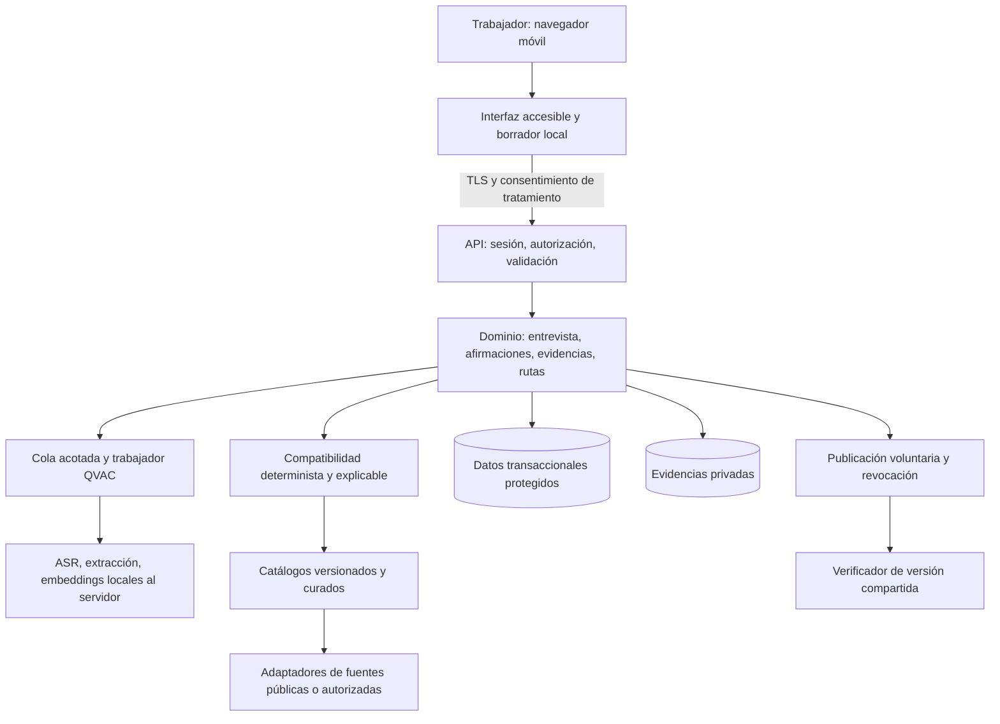

# Arquitectura propuesta

Fecha: 20-10-2026. **Recomendación, sin implementación.** Punto de partida comprobado: solo existe el spike y la preparación de datos; véase [diagnóstico](01_DIAGNOSTICO_GENERAL.md). Las bases oficiales, p. 2, sitúan QVAC en un backend del ecosistema usuario/MTPE; no obligan a inferencia en el navegador o teléfono.

## Decisión de diseño recomendada

Empezar con un **monolito modular TypeScript**: interfaz web móvil, API y dominio separados, y un proceso trabajador para QVAC. Compartir contratos de datos, no estado global ni llamadas al SDK desde componentes visuales. Evitar microservicios, Kubernetes, blockchain y una app nativa en el plazo del concurso: no resuelven los bloqueadores actuales y multiplican despliegue, pruebas y operación.

Propuesta concreta: React + Vite para la interfaz, Node.js con Fastify para API y validación de contratos; trabajador QVAC con la versión verificada y fijada del SDK. Usar versiones soportadas y fijarlas al comenzar implementación, con lockfile y comprobación de compatibilidad; esta auditoría no afirma compatibilidad de una combinación aún no probada. SQLite sirve para demo de una instancia; PostgreSQL y almacenamiento privado de objetos para MVP multiusuario. Son recomendaciones, no dependencias actuales.

El diagrama representa el diseño futuro. El prototipo corre en infraestructura del equipo, rotulada como tal: no equivale a alojamiento ministerial ni a conexión autorizada con gob.pe.

## Límites y estructura de módulos

| Capa propuesta | Responsabilidad | Contrato / aislamiento |
|---|---|---|
| `apps/web` | Formularios, grabación, corrección, consentimiento, vista previa | No decide competencias ni importa QVAC |
| `apps/api` | Sesión, propiedad del recurso, límites de entrada, códigos de error | Todas las consultas incluyen sujeto autorizado |
| `apps/worker-ia` | Ciclo de modelos y trabajos cancelables | Sin permisos para publicar pasaportes o enviar mensajes |
| `packages/dominio` | Estados y reglas de competencias/evidencias/rutas | Funciones comprobables sin SDK ni proveedor externo |
| `packages/contratos` | Esquemas, enumeraciones, versiones y errores | Validación en servidor; frontend no es autoridad |
| `packages/integraciones` | Fuentes de estándares, demanda, vacantes y formación | Interfaces estables con implementación manual o autorizada |
| `datos/` | Fuentes inmutables y transformaciones reproducibles | Fecha, hash, licencia/condiciones y revisión de cambios |

`spike-qvac/` se conserva como experimento; no se convierte en servicio mediante exponerlo por HTTP. Actualmente depende del directorio de ejecución, escribe resultados completos y termina el proceso ante errores (`competencias.mjs`:33,150–156). Crear el producto en otra carpeta respeta `AGENTS.md`.

## Modelo de información

Entidades mínimas: `PerfilTrabajador`, `ConsentimientoVersionado`, `Entrevista`, `FragmentoRelato`, `ActividadPropuesta`, `AfirmacionCompetencia`, `Evidencia`, `RevisionEvidencia`, `EstandarVersionado`, `Ocupacion`, `RelacionCatalogos`, `ObservacionDemanda`, `Vacante`, `OfertaFormativa`, `Ruta`, `PublicacionPasaporte` y `EventoAuditoria`.

- La afirmación guarda quién declaró/confirmó, código y versión del estándar si existe, fragmentos que la sustentan, fecha y alcance. Una habilidad fuera de catálogo conserva su descripción; no se fuerza un código oficial.
- Guardar por separado **declaración del trabajador**, **documentos aportados**, **respaldo de terceros** y **certificación oficial validada por fuente autorizada**. Son dimensiones de evidencia; una foto no asciende automáticamente a verificación. Una firma propia autentica una versión de documento, no certifica una competencia.
- Correcciones invalidan propuestas y recomendaciones derivadas; conservar versiones y la razón, sin retener indefinidamente relatos descartados. Eliminar evidencia retira sus referencias y afecta la publicación asociada.
- Cada fuente registra URL, entidad, fecha de publicación/consulta, territorio, cobertura, vigencia y método de obtención. CNO, CIUO, perfiles y estándares son catálogos distintos: cruces curados, con procedencia y revisión; no deducir equivalencia por nombre similar.

## IA local eficiente y verificable

1. Texto siempre disponible. Audio optativo, breve y con control de detener, escuchar y borrar. En web, ASR en backend requiere transmitir audio con información clara al usuario. No usar reconocimiento del navegador como reemplazo silencioso: su procesamiento puede ser remoto.
2. Normalizar formato de audio con límites; cargar ASR y liberar antes de la siguiente etapa. Preparar modelos previamente y comprobar integridad, licencia y disponibilidad. Medir arranque frío, no solo inferencia caliente.
3. Extraer actividades con esquema y límites de longitud/cantidad. Validar JSON, códigos, índices y que cada cita exista en el relato; una cita real aún puede sustentar una inferencia incorrecta.
4. Pedir familia de oficio, recuperar candidatos por catálogo curado y embeddings. Permitir varias familias y salida fuera de catálogo para no borrar el multioficio. Índice ligado a hash de datos, modelo y versión del esquema. Puntaje de similitud no es probabilidad de competencia. El store RAG integrado de QVAC se limita a prototipos según su documentación: para producción usar un adaptador de búsqueda y persistencia evaluada (por ejemplo SQLite o PostgreSQL/pgvector según escala), sin mezclar relatos de usuarios con el índice público. Véase [RAG oficial](https://docs.qvac.tether.io/sdk/ai-capabilities/rag).
5. Preguntas adaptativas acotadas por plantillas y campos faltantes. El modelo redacta propuestas; el dominio impide inventar códigos, certificaciones, vacantes o acciones externas. Abstenerse y ofrecer aclaración cuando falte evidencia.
6. La persona acepta, corrige o descarta. Solo afirmaciones confirmadas alimentan el motor, conservando su condición de autodeclaración.

Cola con concurrencia limitada por memoria medida, cuotas por sesión, cancelación, timeout y contrapresión. Un proceso separado permite recuperar fallos de motores nativos. No mantener todos los modelos cargados si el benchmark de memoria no lo permite. La versión actual de v2 carga el LLM antes de embeddings (`competencias_v2.mjs`:46,53); no es una política de capacidad para producción.

## Compatibilidad y ruta explicables

Filtrar primero restricciones obligatorias y verificables: territorio aceptado por el usuario, horario, presupuesto, requisitos de acceso y vigencia. Luego ordenar por cobertura de requisitos, evidencia y preferencias declaradas. Mostrar cuáles coinciden, cuáles no están evaluados y cuáles faltan. Un requisito crítico pendiente no se compensa con muchas coincidencias menores.

Para la demo, preferir requisitos y estados explícitos, sin porcentaje. Si después se usa un puntaje, definir `cobertura declarada = suma(peso de requisitos confirmados) / suma(pesos de todos los requisitos definidos del perfil)`, con pesos curados y versión visible. El denominador incluye también los requisitos aún no preguntados o desconocidos; no se reduce a los respondidos. Mostrar aparte cuánto del perfil se ha podido evaluar: un confirmado y nueve desconocidos no se muestran como cobertura completa ni como nueve incapacidades. Separar cobertura de confianza/evidencia y de demanda. No mostrarlo como probabilidad de contratación, certificación o dominio del oficio. Cuando el perfil no tenga requisitos definidos o fuente suficiente, mostrar información insuficiente. La EDO aporta contexto agregado; una vacante requiere un anuncio identificable y vigente.

El primer paso es una acción comprobable: requisitos, costo conocido o por consultar, duración/modalidad, horario y contacto. Si no hay oferta compatible, explicarlo y permitir cambiar restricciones; no generar un curso plausible con IA.

## Persistencia, offline y recuperación

En la web, cachear interfaz y catálogos permitidos; guardar borrador mínimo optativo, con aviso y opción de borrarlo en equipos compartidos. IndexedDB no ofrece por sí sola confidencialidad frente a XSS o acceso al mismo perfil del navegador. No conservar audio/documentos sensibles por defecto. Usar almacenamiento cifrado donde haya gestión de claves defendible; no poner la clave junto al contenido como supuesta protección.

La primera visita sin recursos descargados no funciona offline. Con recursos cacheados, texto, revisión y consulta de catálogo local pueden operar sin red. La inferencia QVAC del backend, la consulta de ofertas actualizadas y la verificación de revocación necesitan conexión. Cola de sincronización con identificadores idempotentes, versión esperada y resolución visible de conflictos; nunca publicar un pasaporte automáticamente al volver la red. Una futura app nativa con QVAC requiere prueba física, consumo y licencia; se pospone.

Servidor: cifrado en tránsito y reposo con claves fuera de la base; acceso mínimo, backups cifrados y restauración probada. Separar metadatos y objetos; plazo por tipo de dato, borrado de derivados y eliminación en backups según política documentada. Autenticación con proveedor OIDC autorizado cuando exista convenio; mientras, identidad propia de piloto claramente delimitada. No fingir login gob.pe ni pedir credenciales ministeriales.

## Evidencias y pasaporte

Carga privada con autorización de propietario, cuota, formatos permitidos, comprobación real de contenido, procesamiento aislado, eliminación de EXIF y análisis antes de acceso de terceros. Una evidencia puede ser pendiente, rechazada o revisada, con motivo. Evitar reconocimiento facial, biometría y detección automática de fraude como criterio decisorio.

QR con identificador aleatorio de alta entropía, alcance, expiración y revocación; sin DNI, teléfono, ubicación precisa ni relato embebidos. Una URL con token es accesible a quien la copie: explicarlo. Vista previa y consentimiento por publicación, proyección de campos permitidos en servidor, límites de consulta y `noindex` como medida complementaria. Firma de un snapshot con claves protegidas cuando sea necesario; especificar emisor y comprobar expiración/revocación online. Un PDF descargado no puede retirarse del dispositivo receptor y la firma offline no prueba vigencia actual.

## Integraciones y operación

Fuente pública documental → importación curada; portal de usuario → enlace oficial; API → adaptador **solo cuando documentación, acceso y autorización estén confirmados**. No scraping autenticado ni endpoints deducidos. Matriz y fuentes oficiales en [seguridad e integraciones](04_AUDITORIA_SEGURIDAD.md). No existe hoy convenio, SSO ni verificador ministerial demostrado.

Observar estados, latencia, cola, memoria, fallos de catálogo y borrados con identificadores técnicos; excluir relatos y documentos de logs/telemetría. CI con validación de datos, dominio, contratos, pruebas del flujo y análisis de dependencias. Desplegar API y worker con almacenamiento persistente, límites y health checks; los trabajos pesados no caben automáticamente en un hosting estático o función efímera. Aceptar esta arquitectura solo después de un spike de compatibilidad y del presupuesto de infraestructura; riesgos y criterios en [pruebas](09_PLAN_PRUEBAS.md) y [roadmap](08_ROADMAP_DESARROLLO.md).

Fuentes: [bases ULima, p. 2](https://www.ulima.edu.pe/sites/default/files/centers/files/1_bases_innovathon_ulima_x_tether_0.pdf), [QVAC SDK](https://docs.qvac.tether.io/sdk/), consultadas el 20-10-2026. Las tecnologías y fórmulas propuestas son criterio de ingeniería, no requisitos del concurso.
